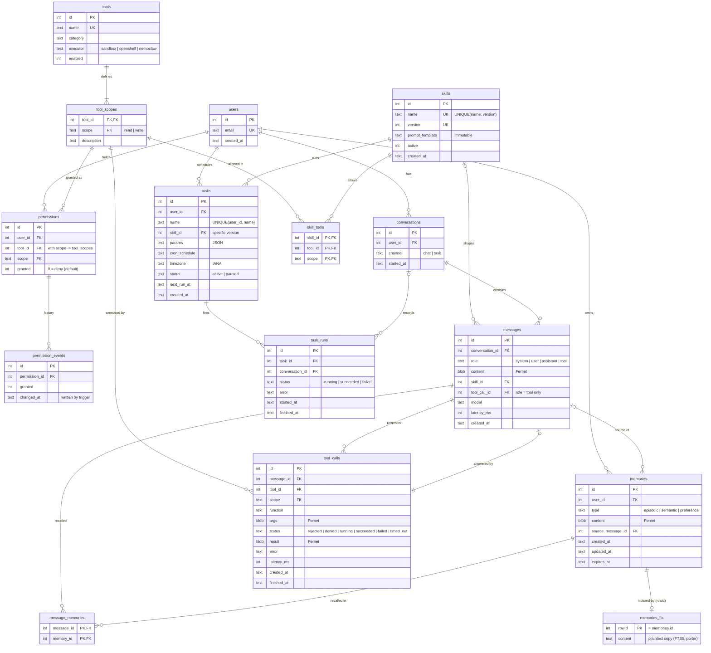

# Custodian schema (v2)

The DDL is in [schema.sql](schema.sql). This page has the diagram and the reasons behind the
design. The diagram is Mermaid: GitHub renders it, and you can paste it into
https://mermaid.live to export an image.

## What changed from the v1 diagram, and why

| v1 problem | Fix in v2 |
|---|---|
| `users` → `skills` line, but `skills` had no `user_id` | Skills are global; the line is gone. |
| `permissions` 1 — * `tools` (backwards) | `tools` 1 — * `tool_scopes` 1 — * `permissions`. |
| "runs" label sat inside `permissions` | It's on `skills` → `tasks`. |
| `granted` + `granted_at` + `revoked_at` could disagree, and an upsert lost earlier grants | `permissions.granted` is the only current state. Every change is appended to `permission_events` by trigger. |
| `scope` was free text; a typo silently never matched | `tool_scopes` lists the valid scopes, and `permissions`, `skill_tools` and `tool_calls` all have foreign keys to it. |
| No link between skills and tools | `skill_tools` is each skill's allowlist, checked in the sandbox together with the user's grants. |
| `skills.name` UNIQUE blocked multiple versions; editing in place changed live tasks | `UNIQUE(name, version)`, rows can't be changed (trigger), `tasks.skill_id` points at a specific version, and `active` allows rollback. |
| `tasks.status` mixed the task's state with run outcomes; no history | `tasks.status` is `active`/`paused` only; each run is a row in `task_runs`, with at most one in progress per task. |
| Cron without a timezone; no template inputs | `tasks.timezone` (IANA) and `tasks.params` (checked with `json_valid`). |
| Task output had nowhere to go | `task_runs.conversation_id` points to a `channel = 'task'` conversation. |
| No record of what tools actually did | `tool_calls` logs every proposed call, including rejected/denied ones. It feeds the permission-block rate and latency evals. |
| `messages.used` JSON could keep references to deleted memories | `messages.skill_id`, `message_memories` and `tool_calls`, all with foreign keys. |
| Chat text stored as plaintext next to encrypted memories | `messages.content`, `tool_calls.args` and `tool_calls.result` are Fernet BLOBs. |
| `memories_fts` had no link back to `memories`, so recall couldn't filter by user and deletes left plaintext behind | `rowid = memories.id`; recall joins on it; a trigger deletes the FTS row, including on cascades from a user delete. |
| No record of where a memory came from | `memories.source_message_id`. |
| `embedding_ref` in the diagram, but the code uses FTS5 | Removed. If vectors are added later, also store the embedding model so you know what to re-embed. |
| Foreign keys never enforced | `app/db.py` runs `PRAGMA foreign_keys = ON` for every connection (SQLite's default is off). |
| No enums, `ON DELETE` rules or indexes | `CHECK` constraints on every enum-like column; deleting a user cascades everywhere; indexes for the scheduler, recall and conversation queries. |
| No schema versioning | `PRAGMA user_version = 2`; `init_db()` refuses a v1 or unknown database instead of half-applying the schema. |

## Deliberately not added

- **A `user_preferences` table.** Fuzzy preferences ("prefers morning meetings") are recalled like
  any other memory, so they stay in `memories` with `type = 'preference'`. The one structured
  setting that is needed now, the timezone, lives on `tasks`.
- **`tasks.last_run_at`, `conversations.updated_at`.** These can be derived from `task_runs` and
  `messages`, so storing them would just create a second copy that can go out of date.
- **Tool input schemas in the database.** The pydantic models in `app/tools/` stay the single
  source of truth for arguments.
