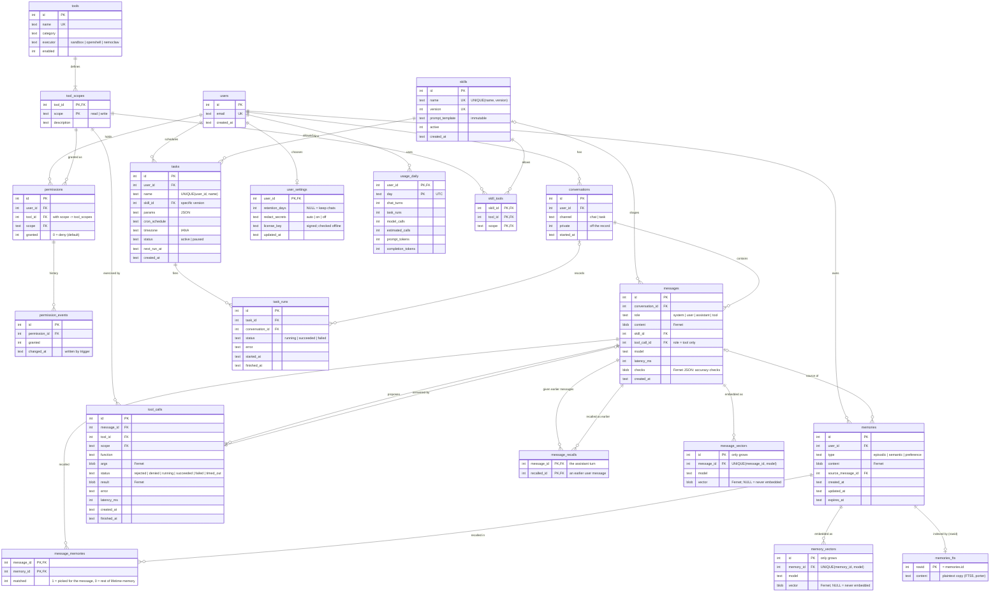

# Custodian schema (v5)

The DDL is in [schema.sql](schema.sql). This page has the diagram and the reasons behind the
design. The diagram is Mermaid: GitHub renders it, and you can paste it into
https://mermaid.live to export an image.

## What v5 adds: accuracy checks, privacy controls and plans

| Need | v5 |
|---|---|
| Show whether a reply's claims were checked, corrected or flagged, also when the chat is reopened | `messages.checks` on the final assistant message: Fernet-encrypted JSON from `app/grounding.py` (status, what was found, memories refused, secrets withheld). `build_used` returns it as `used.checks`; older replies have NULL. |
| Chats that are never remembered or recalled | `conversations.private`. History search and embedding skip their messages, `remember` isn't offered, and the hourly job deletes them a day after the last message. |
| Retention and secret withholding are the user's choice | `user_settings.retention_days` and `redact_secrets`; a missing row means the defaults (keep chats, withhold secrets when the model is on the internet). |
| A license activated in the app | `user_settings.license_key`, verified offline on every plan check (`app/licensing.py`), so a tampered value is simply ignored. |
| Usage that survives deleting chats, without keeping content | `usage_daily`: counters per user and UTC day, upserted by `app/usage.py`. |
| Existing v4 databases | `db.MIGRATIONS[4]` adds the two columns and two tables in one transaction. |

## What v4 adds: search by meaning

| Need | v4 |
|---|---|
| Find "I lent my umbrella to Kavya" from "who has my brolly?" - no word in common | `memory_vectors` and `message_vectors` hold an embedding of every memory and user message. `app/vectors.py` searches them in RAM and its ranking is fused with the keyword ranking (reciprocal rank fusion). |
| A vector can be partly turned back into its text | `vector` is Fernet ciphertext, like the text it comes from; `rotate-keys` covers it. |
| Never send a secret to an embedding endpoint, and don't keep retrying it | A row with `vector IS NULL` marks an item deliberately not embedded. |
| Changing the embedding model | Rows are per `model`; the new model embeds everything again in the background and old rows are ignored. |
| Rows written by another process (a CLI run) | The `AUTOINCREMENT` id only grows, so each process loads the rows above the last one it saw. |
| Deleted or edited items | `ON DELETE CASCADE` removes a deleted item's vectors; editing a memory deletes its vector so it is embedded again. |
| Existing v3 databases | `db.MIGRATIONS[3]` creates both tables; the server embeds existing data on its next start. |

## What v3 adds: lifetime memory

Every chat, including a new one, now gets the user's whole lifetime memory that fits the
prompt, plus what they said in earlier conversations that matches the message.

| Need | v3 |
|---|---|
| Every memory reaches every chat, not just the top 5 keyword hits | `orchestrator` puts all memories that fit a budget in the prompt, keyword matches first. `message_memories.matched` keeps the difference visible: 1 for the ones picked for the message (what v2 linked), 0 for the rest. |
| Things said in passing in old chats, never saved as memories | `app/history_search.py` searches every user message by keyword. Its FTS5 index lives in the server's memory, built from the decrypted messages, so message text stays encrypted at rest (unlike `memories_fts`). |
| Show which earlier messages shaped a reply, and never point at deleted text | `message_recalls`, with `ON DELETE CASCADE` on both sides, so `used.earlier` is rebuilt from foreign keys like the rest of `used`. |
| Existing v2 databases | `db.MIGRATIONS[2]` adds the column and table in one transaction; old links get `matched = 1`. |

## What changed from the v1 diagram, and why

| v1 problem | Fix in v2 |
|---|---|
| `users` → `skills` line, but `skills` had no `user_id` | Skills are global; the line is gone. |
| `permissions` 1 — * `tools` (backwards) | `tools` 1 — * `tool_scopes` 1 — * `permissions`. |
| "runs" label sat inside `permissions` | It's on `skills` → `tasks`. |
| `granted` + `granted_at` + `revoked_at` could disagree, and an upsert lost earlier grants | `permissions.granted` is the only current state. Every change is appended to `permission_events` by trigger. |
| `scope` was free text; a typo silently never matched | `tool_scopes` lists the valid scopes, and `permissions`, `skill_tools` and `tool_calls` all have foreign keys to it. |
| No link between skills and tools | `skill_tools` is each skill's allowlist, checked in the sandbox together with the user's grants. |
| `skills.name` UNIQUE blocked multiple versions; editing in place changed live tasks | `UNIQUE(name, version)`, rows can't be changed (trigger), `tasks.skill_id` points at a specific version, and `active` allows rollback. |
| `tasks.status` mixed the task's state with run outcomes; no history | `tasks.status` is `active`/`paused` only; each run is a row in `task_runs`, with at most one in progress per task. |
| Cron without a timezone; no template inputs | `tasks.timezone` (IANA) and `tasks.params` (checked with `json_valid`). |
| Task output had nowhere to go | `task_runs.conversation_id` points to a `channel = 'task'` conversation. |
| No record of what tools actually did | `tool_calls` logs every proposed call, including rejected/denied ones. It feeds the permission-block rate and latency evals. |
| `messages.used` JSON could keep references to deleted memories | `messages.skill_id`, `message_memories` and `tool_calls`, all with foreign keys. |
| Chat text stored as plaintext next to encrypted memories | `messages.content`, `tool_calls.args` and `tool_calls.result` are Fernet BLOBs. |
| `memories_fts` had no link back to `memories`, so recall couldn't filter by user and deletes left plaintext behind | `rowid = memories.id`; recall joins on it; a trigger deletes the FTS row, including on cascades from a user delete. |
| No record of where a memory came from | `memories.source_message_id`. |
| `embedding_ref` in the diagram, but the code uses FTS5 | Removed. If vectors are added later, also store the embedding model so you know what to re-embed. |
| Foreign keys never enforced | `app/db.py` runs `PRAGMA foreign_keys = ON` for every connection (SQLite's default is off). |
| No enums, `ON DELETE` rules or indexes | `CHECK` constraints on every enum-like column; deleting a user cascades everywhere; indexes for the scheduler, recall and conversation queries. |
| No schema versioning | `PRAGMA user_version` (now 5); `init_db()` upgrades a v2, v3 or v4 file in place with `db.MIGRATIONS` and refuses a v1 or unknown database instead of half-applying the schema. |

## Deliberately not added

- **A `user_preferences` table.** Fuzzy preferences ("prefers morning meetings") are recalled like
  any other memory, so they stay in `memories` with `type = 'preference'`. `user_settings` holds
  only switches the server itself acts on (retention, secret withholding, the license); the
  timezone lives on `tasks`.
- **`tasks.last_run_at`, `conversations.updated_at`.** These can be derived from `task_runs` and
  `messages`, so storing them would just create a second copy that can go out of date.
- **Tool input schemas in the database.** The pydantic models in `app/tools/` stay the single
  source of truth for arguments.

## Where tool data lives

Calendar events and notes are not in this schema. Each tool keeps its own SQLite file under
`DATA_DIR/tools/<tool>/` (`calendar/calendar.db`, `notes/notes.db`). Tools run in a separate
sandboxed process that may only open files in its own folder, so a tool never needs, or can
reach, `custodian.db` - including the `permissions` table that decides whether it may run.
`python -m app.cli backup` copies the main database and every tool database together.
